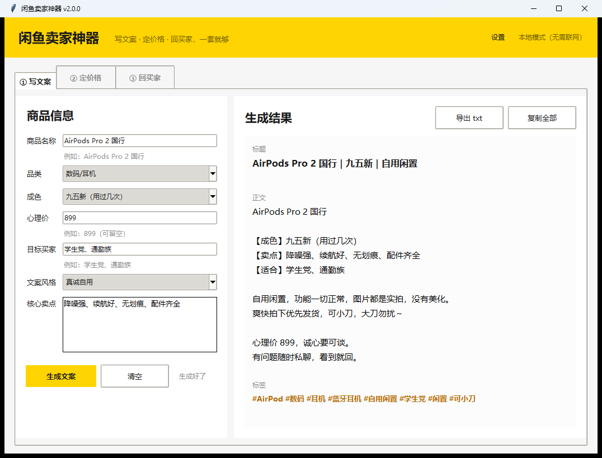
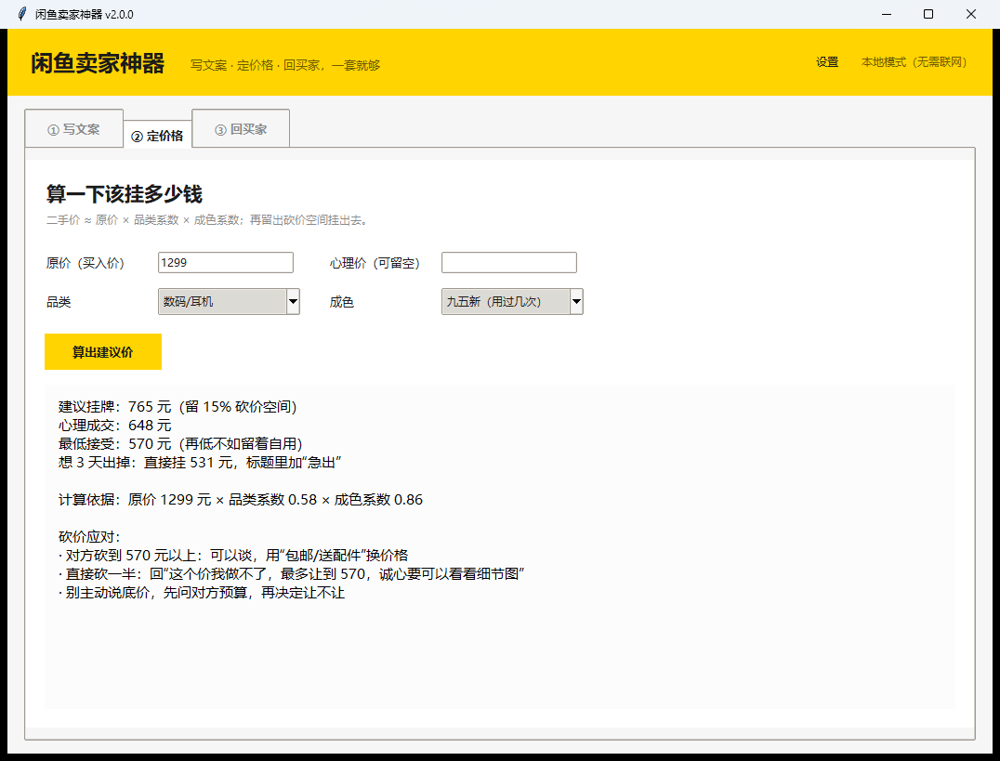
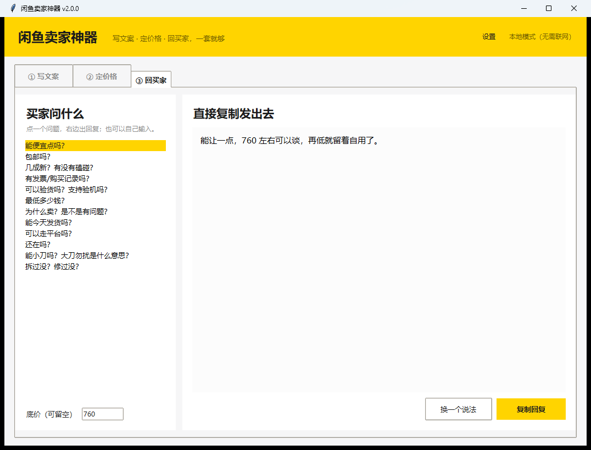

# 闲鱼卖家神器 v2.0

> 写文案、定价、回买家——闲鱼卖家的三件套，一个桌面小工具全搞定。

纯 Python + tkinter，单个 `app.py`，不装依赖也能跑（标准库足够）；可选接入 DeepSeek，效果更好。

## 下载即用（Windows，无需装 Python）

去 [Releases](https://github.com/qiancheng19494/xianyu-seller-kit/releases) 下载 `xianyu-seller-kit_v2.0.0_win64.zip`：

1. 解压得到 `闲鱼卖家神器` 文件夹
2. 双击里面的 `闲鱼卖家神器.exe`
3. 首次运行 Windows 可能弹 SmartScreen → 「更多信息」→「仍要运行」

> 注意：整份文件夹要一起拷贝，只拿 exe 出来会因为缺少 `_internal` 而启动失败。
> 本版是目录版（onedir）打包；单文件版在测试机上因临时目录受限打不开，故未放出。



## 三个页签，对应卖货的三个环节

| 页签 | 干什么 |
|---|---|
| ① 写文案 | 填商品名、品类、成色、卖点、目标买家，一键出「标题 + 正文 + 标签」 |
| ② 定价格 | 按「原价 × 品类系数 × 成色系数」算出挂牌价、心理成交价、最低接受价，并给砍价应对话术 |
| ③ 回买家 | 12 类常见问题（能便宜点吗 / 包邮吗 / 能小刀吗 / 还在吗…）点一下就出回复，可带底价 |





## 快速开始

需要 Python 3.10+（tkinter 随官方安装包自带）。

```bash
# 方式一：双击 start.bat
# 方式二：命令行
python app.py
```

填写 → 点「生成文案」→ 点「复制全部」→ 去闲鱼发布页粘贴。

## 接入 DeepSeek（可选）

不填 Key 走**本地模板引擎**，离线可用、秒出结果；填了 Key 就走大模型，文案更自然。

1. 在 https://platform.deepseek.com/api_keys 创建 Key
2. 复制 `config.example.json` 为 `config.json`，把 Key 填进 `api_key`
   （或直接在软件里点「设置」填）
3. 重启软件，右上角显示「大模型模式」

`config.json` 已在 `.gitignore` 里，不会被提交。

## 打包成 exe

```bash
pip install pyinstaller
python -m PyInstaller --noconfirm --clean --onefile --windowed `
  --name 闲鱼卖家神器 app.py
```

产物在 `dist/闲鱼卖家神器.exe`，拷给没装 Python 的电脑也能双击运行。

## 目录结构

```
xianyu-copywriter/
├─ app.py                 主程序（UI + 本地引擎 + DeepSeek 调用）
├─ start.bat              Windows 双击启动
├─ config.example.json    配置模板（复制成 config.json 再用）
├─ 买家必读.txt            给买家的使用说明
├─ listing.md             上架文案草稿
└─ ui-*.png               界面截图
```

## 本地引擎怎么算的

- **文案**：品类词库 + 成色/卖点/人群模板拼装，标题控制 30 字内，正文分段口语化，附 8-10 个话题标签。
- **定价**：`二手价 ≈ 原价 × 品类系数(0.5~0.75) × 成色系数(0.7~0.95)`；挂牌价上浮 18% 留砍价空间，底价下浮 12%，急出再打 0.82。
- **话术**：12 类买家问题 → 固定策略（不主动说底价、先问预算、给「包邮/送配件」换价格）。

想改系数或话术，直接改 `app.py` 顶部的常量与字典即可。

## 常见问题

**Q：提示没检测到 Python？**
装 python.org 官方版，安装时勾选 *Add Python to PATH*，装完重开。

**Q：API 报 401 / 超时？**
Key 错了或过期；也可能是网络到不了 `api.deepseek.com`。先把 Key 清空切回本地模式验证软件本身没问题。

**Q：能批量生成吗？**
当前一次一个商品，生成后可以接着改下一个。

**Q：能自动发布到闲鱼吗？**
不能，也**不建议**做自动发布——违反平台规则、有封号风险。这个工具止步于「复制到剪贴板」，发布这一步留给人。

## 免责声明

仅辅助文案与定价参考，商品信息请如实描述；因发布内容产生的纠纷由使用者自行负责。

## License

未指定 License，保留所有权利。要开源请自行添加 LICENSE 文件。
