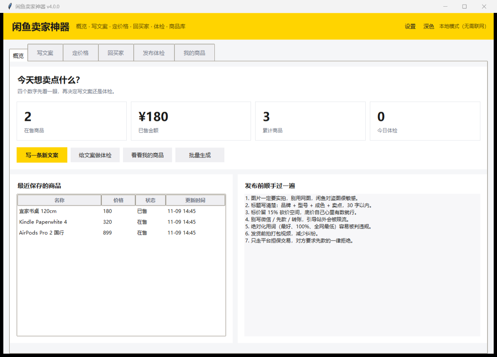
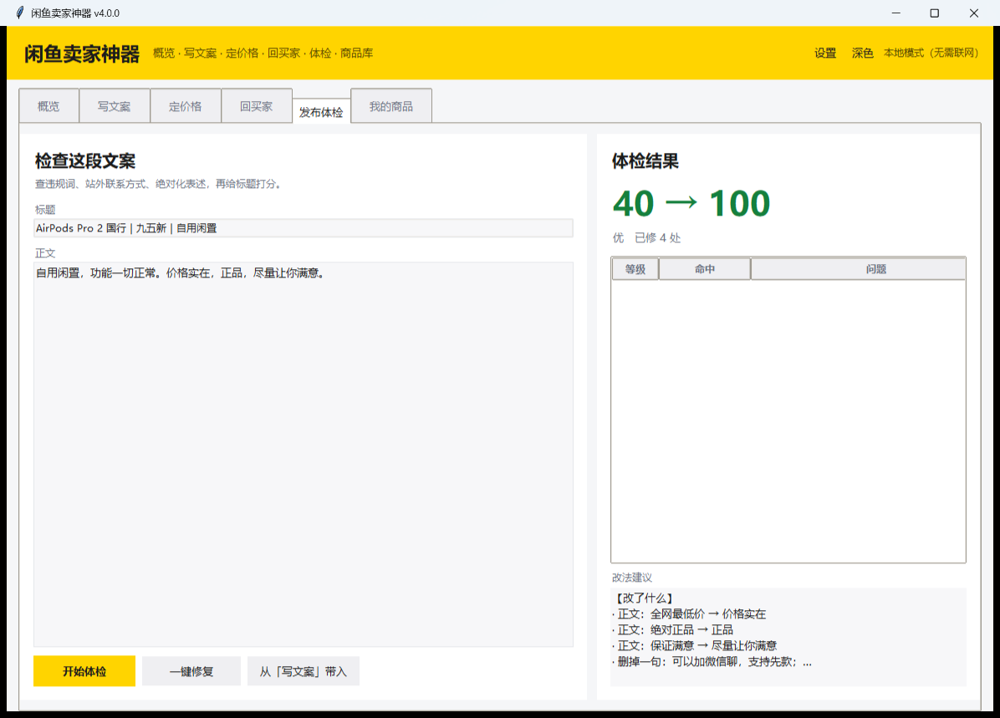
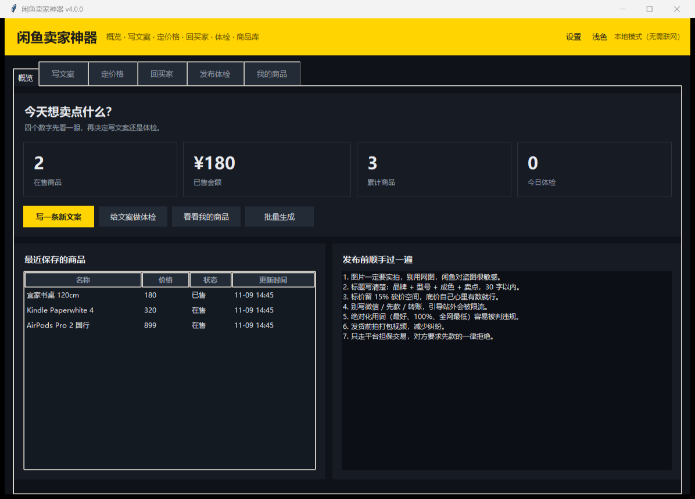

# 闲鱼卖家神器 v4.0

> 写文案、定价、回买家、发布体检（一键修复）、管商品、批量生成——闲鱼卖家的六件套，
> 一个桌面小工具全搞定。浅色/深色主题可切。

纯 Python + tkinter，标准库即可运行；可选接入 DeepSeek，文案更自然。

## 下载即用（Windows，无需装 Python）

去 [Releases](https://github.com/qiancheng19494/xianyu-seller-kit/releases) 下载 `xianyu-seller-kit_v4.0.0_win64.zip`：

1. 解压得到 `闲鱼卖家神器` 文件夹
2. 双击里面的 `闲鱼卖家神器.exe`
3. 首次运行 Windows 可能弹 SmartScreen →「更多信息」→「仍要运行」

> 注意：整份文件夹要一起拷贝，只拿 exe 出来会因为缺少 `_internal` 而启动失败。
> 本版是目录版（onedir）打包；单文件版在测试机上因临时目录受限打不开，故未放出。



## 六个页签，覆盖卖货全流程

| 页签 | 干什么 |
|---|---|
| ⓪ 概览 | 一眼看：在售数、已售金额、累计商品、今日体检次数；最近保存的商品；发布前 7 条提醒 |
| ① 写文案 | 填商品名、品类、成色、卖点、目标买家，一键出「标题 + 正文 + 标签」，另给 3 个标题候选，可批量生成 |
| ② 定价格 | 按「原价 × 品类系数 × 成色系数」算挂牌价、心理成交价、最低接受价，并给砍价应对 |
| ③ 回买家 | 12 类常见问题点一下就出回复，可带底价；支持自己加话术 |
| ④ 发布体检 | 查违规词、站外联系方式、绝对化表述，给 0-100 分与改法；**一键修复**自动改写并复检 |
| ⑤ 我的商品 | 保存商品到本地 SQLite，按状态/关键词筛选，标记在售/已售，导出 CSV |



## 深色主题

右上角「深色 / 浅色」一点即切，选择会记住。



## v4.0 更新了什么

- **概览页（新）**：在售数、已售金额、累计商品、今日体检，加最近商品与发布提醒，打开就知道今天该干啥。
- **一键修复（新）**：体检页点一下，自动把「全网最低价 / 绝对 / 保证」换成不踩雷的说法，删掉含微信、先款、转账的句子，然后立刻复检、显示 `40 → 100` 的前后对比；改不动的（高仿、刷单）会单独列出来让你手动处理。
- **批量生成（新）**：一行一个商品（名称, 品类, 成色, 价格, 卖点, 风格），一次出 N 条文案，带体检分，可一键全部存进商品库。
- **浅色/深色主题（新）**：`theme.py` 两套色板，ttk 走样式、tk 原生控件递归刷色，切主题不重启。
- 页签索引改成常量（`TAB_OVERVIEW`…`TAB_MINE`），新增页签不会再错位。

## 快速开始

需要 Python 3.10+（tkinter 随官方安装包自带）。

```bash
python app.py            # 正常打开
python app.py --demo 1   # 自动填示例：1 写文案 / 2 定价 / 3 回买家 / 4 体检 / 5 商品库
                         # 6 概览 / 7 切主题 / 8 体检+一键修复 / 9 深色写文案
```

填写 → 点「生成文案」→ 点「复制全部」→ 去闲鱼发布页粘贴；想留档就点「保存到商品库」。

## 批量生成

写文案页点「批量生成」，每行一个商品：

```
AirPods Pro 2, 数码/耳机, 九五新, 899, 降噪强、续航好
Kindle Paperwhite 4, 数码, 九成新, 320, 看书神器、送保护套
```

品类/成色写个大概也能认（「数码」→「数码/耳机」、「九成新」→「九成新（正常使用）」）。
生成后每条都带体检分，确认没问题点「全部存到商品库」（状态为草稿）。

## 接入 DeepSeek（可选）

不填 Key 走**本地引擎**，离线可用、秒出结果；填了 Key 走大模型润色。

1. 在 https://platform.deepseek.com/api_keys 创建 Key
2. 软件里点右上角「设置」填进去，或复制 `config.example.json` 为 `config.json` 手填
3. 右上角显示「AI 模式（DeepSeek）」即生效

`config.json` 已在 `.gitignore` 里，不会被提交。

## 数据存在哪

- 商品库与自定义话术：`data/seller.db`（源码），打包版优先放 exe 同级的 `data/` 里，写不了才退到 `%LOCALAPPDATA%\XianyuSellerKit\`
- 配置（API Key / 主题）：同目录下 `config.json`
- 都不上传、不联网（除非你开了 AI 模式）

## 打包成 exe

```bash
pip install pyinstaller
python -m PyInstaller --noconfirm --clean --onedir --windowed --name 闲鱼卖家神器 \
  --distpath dist5 --workpath build5 --specpath build5 app.py
```

产物在 `dist5/闲鱼卖家神器/`，整个文件夹拷给没装 Python 的电脑即可。

> 排查打包版问题的小技巧：加 `--console` 再打一个版本，报错才看得见（`--windowed` 会把
> Python 的 traceback 吞掉，只剩一句「Could not create temporary directory」之类）。

## 目录结构

```
xianyu-copywriter/
├─ app.py                 UI（六页签、主题切换、批量生成、设置、demo）
├─ engine.py              文案/定价/话术/体检/一键修复/批量的纯逻辑
├─ store.py               SQLite 商品库与自定义话术
├─ theme.py               浅色/深色两套色板与 ttk 样式
├─ start.bat              Windows 双击启动
├─ config.example.json    配置模板
└─ ui-v4-*.png            界面截图
```

## 本地引擎怎么算的

- **文案**：品类词库 + 成色/卖点/人群模板拼装，标题 30 字内，正文分段口语化，附 8-9 个话题标签。
- **定价**：`二手价 ≈ 原价 × 品类系数(0.28~0.62) × 成色系数(0.50~1.08)`；挂牌上浮 18%，底价下浮 12%，急出再 ×0.82。
- **话术**：12 类买家问题 → 固定策略（不主动说底价、先问预算、用「包邮/送配件」换价格）。
- **体检**：高风险词 −18/条，中风险词 −8/条，标题检查 −4/条，100 分制。
- **一键修复**：绝对化词按对照表换掉（全网最低价→价格实在、绝对正品→正品…），含站外联系/先款的整句删掉；高仿、刷单这类改了会歪曲事实的词只提示、不自动改。

改系数或词表，直接改 `engine.py` 顶部常量（`CATEGORIES`/`CONDITIONS`/`RISK_HIGH`/`REPAIR_MAP`）。

## 常见问题

**Q：提示没检测到 Python？**
装 python.org 官方版，安装时勾选 *Add Python to PATH*，装完重开终端。

**Q：API 报 401 / 超时？**
Key 错了或过期，或网络到不了 `api.deepseek.com`。清空 Key 切回本地模式可验证软件本身正常。

**Q：体检说我文案有风险，但我就是想这么写？**
体检只是提示，最终发什么你决定；高风险词（微信、先款、高仿）确实容易限流或删帖。

**Q：一键修复会不会把我文案改坏？**
它只做两类动作：按对照表换绝对化词、删掉整句站外联系方式。改完立刻复检并把「改了什么」列出来，你不满意可以撤回（关掉不保存即可）。

**Q：能自动发布到闲鱼吗？**
不能，也**不建议**——违反平台规则、有封号风险。工具止步于「复制到剪贴板」，发布留给人。

## 免责声明

仅辅助文案与定价参考，商品信息请如实描述；因发布内容产生的纠纷由使用者自行负责。

## License

未指定 License，保留所有权利。要开源请自行添加 LICENSE 文件。
