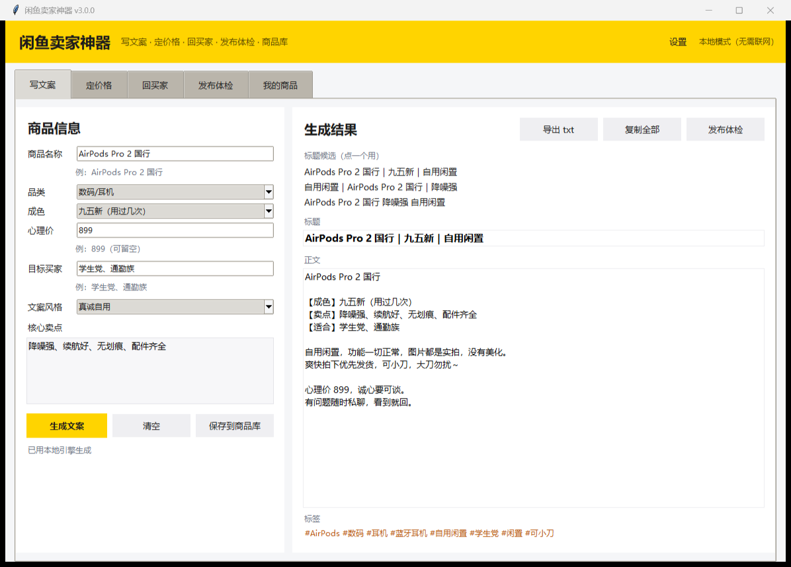
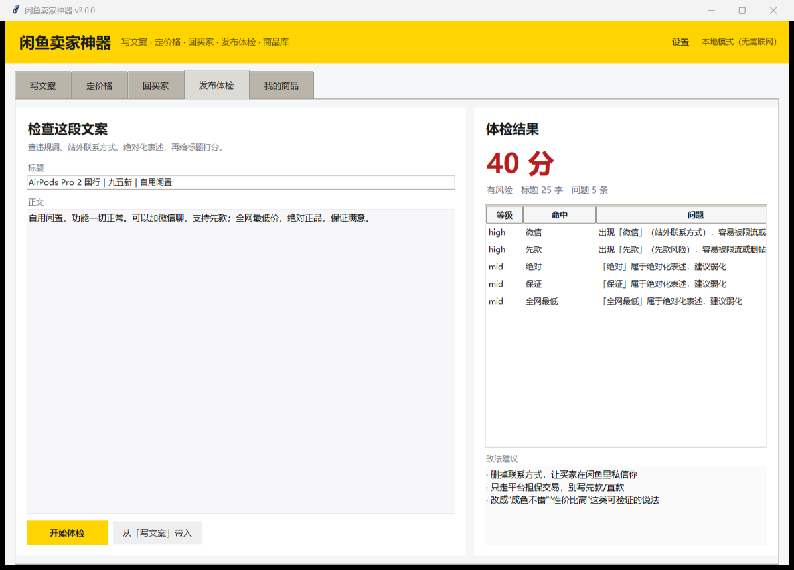
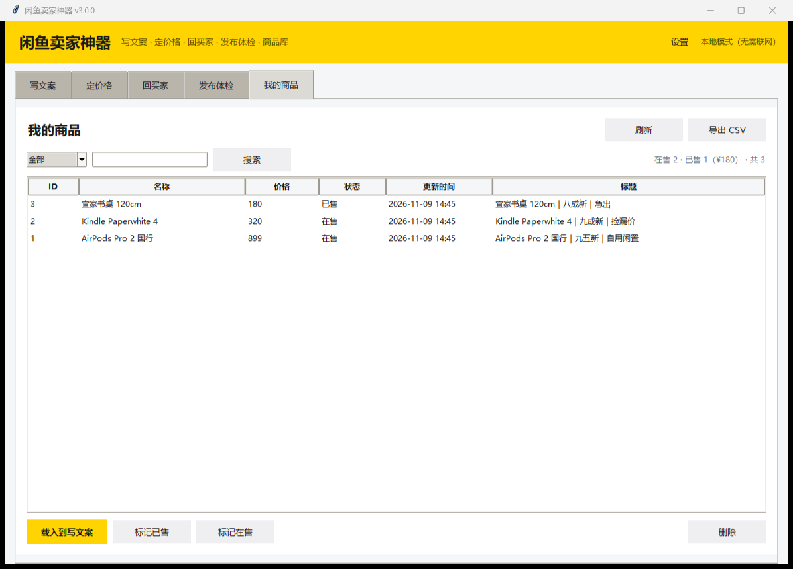

# 闲鱼卖家神器 v3.0

> 写文案、定价、回买家、发布体检、管商品——闲鱼卖家的五件套，一个桌面小工具全搞定。

纯 Python + tkinter，标准库即可运行；可选接入 DeepSeek，文案更自然。

## 下载即用（Windows，无需装 Python）

去 [Releases](https://github.com/qiancheng19494/xianyu-seller-kit/releases) 下载 `xianyu-seller-kit_v3.0.0_win64.zip`：

1. 解压得到 `闲鱼卖家神器` 文件夹
2. 双击里面的 `闲鱼卖家神器.exe`
3. 首次运行 Windows 可能弹 SmartScreen → 「更多信息」→「仍要运行」

> 注意：整份文件夹要一起拷贝，只拿 exe 出来会因为缺少 `_internal` 而启动失败。
> 本版是目录版（onedir）打包；单文件版在测试机上因临时目录受限打不开，故未放出。



## 五个页签，覆盖卖货全流程

| 页签 | 干什么 |
|---|---|
| ① 写文案 | 填商品名、品类、成色、卖点、目标买家，一键出「标题 + 正文 + 标签」，另给 3 个标题候选 |
| ② 定价格 | 按「原价 × 品类系数 × 成色系数」算挂牌价、心理成交价、最低接受价，并给砍价应对 |
| ③ 回买家 | 12 类常见问题点一下就出回复，可带底价；支持自己加话术 |
| ④ 发布体检 | 查违规词、站外联系方式、绝对化表述，给 0-100 分和改法建议 |
| ⑤ 我的商品 | 保存商品到本地 SQLite，按状态/关键词筛选，标记在售/已售，导出 CSV |





## v3.0 更新了什么

- **发布体检（新）**：内置高风险词表（站外联系方式、先款/转账、高仿、刷单、破解…）＋ 正则识别手机号/邮箱/外链/QQ ＋ 绝对化词表，按 高-18 / 中-8 / 低-4 扣分，输出分数、等级、逐条问题与改法。
- **我的商品（新）**：SQLite 商品库，保存文案、价格、底价、状态；双击载入回写文案页；统计在售数与已售金额。
- **自定义话术（新）**：内置 12 问之外，可自己加「能试用吗？」这类问题与回复，存本地库，随时改删。
- **标题候选**：每次生成给 3 个 ≤30 字的不同结构标题，点一下替换。
- **工程拆分**：`engine.py`（纯逻辑，可单测）/ `store.py`（SQLite）/ `app.py`（UI），不再是一个大文件。

## 快速开始

需要 Python 3.10+（tkinter 随官方安装包自带）。

```bash
python app.py            # 正常打开
python app.py --demo 1   # 自动填示例：1 写文案 / 2 定价 / 3 回买家 / 4 体检 / 5 商品库
```

填写 → 点「生成文案」→ 点「复制全部」→ 去闲鱼发布页粘贴；想留档就点「保存到商品库」。

## 接入 DeepSeek（可选）

不填 Key 走**本地引擎**，离线可用、秒出结果；填了 Key 走大模型润色。

1. 在 https://platform.deepseek.com/api_keys 创建 Key
2. 软件里点右上角「设置」填进去，或复制 `config.example.json` 为 `config.json` 手填
3. 右上角显示「AI 模式（DeepSeek）」即生效

`config.json` 已在 `.gitignore` 里，不会被提交。

## 数据存在哪

- 商品库与自定义话术：`data/seller.db`（源码），打包版优先放 exe 同级的 `data/` 里，写不了才退到 `%LOCALAPPDATA%\XianyuSellerKit\`
- 配置：同目录下 `config.json`
- 都不上传、不联网（除非你开了 AI 模式）

## 打包成 exe

```bash
pip install pyinstaller
python -m PyInstaller --noconfirm --clean --onedir --windowed --name 闲鱼卖家神器 app.py
```

产物在 `dist/闲鱼卖家神器/`，整个文件夹拷给没装 Python 的电脑即可。

## 目录结构

```
xianyu-copywriter/
├─ app.py                 UI（五个页签、设置、demo）
├─ engine.py              文案/定价/话术/体检的纯逻辑
├─ store.py               SQLite 商品库与自定义话术
├─ start.bat              Windows 双击启动
├─ config.example.json    配置模板
├─ 买家必读.txt            给买家的使用说明
├─ listing.md             上架文案草稿
└─ ui-v3-*.png            界面截图
```

## 本地引擎怎么算的

- **文案**：品类词库 + 成色/卖点/人群模板拼装，标题 30 字内，正文分段口语化，附 8-9 个话题标签。
- **定价**：`二手价 ≈ 原价 × 品类系数(0.28~0.62) × 成色系数(0.50~1.08)`；挂牌上浮 18%，底价下浮 12%，急出再 ×0.82。
- **话术**：12 类买家问题 → 固定策略（不主动说底价、先问预算、用「包邮/送配件」换价格）。
- **体检**：高风险词 −18/条，中风险 −8/条，标题检查 −4/条，100 分制。

改系数或词表，直接改 `engine.py` 顶部常量。

## 常见问题

**Q：提示没检测到 Python？**
装 python.org 官方版，安装时勾选 *Add Python to PATH*，装完重开终端。

**Q：API 报 401 / 超时？**
Key 错了或过期，或网络到不了 `api.deepseek.com`。清空 Key 切回本地模式可验证软件本身正常。

**Q：体检说我文案有风险，但我就是想这么写？**
体检只是提示，最终发什么你决定；高风险词（微信、先款、高仿）确实容易限流或删帖。

**Q：能批量生成吗？**
当前一次一个商品；商品库可以存多条，双击载入继续改。

**Q：能自动发布到闲鱼吗？**
不能，也**不建议**——违反平台规则、有封号风险。工具止步于「复制到剪贴板」，发布留给人。

## 免责声明

仅辅助文案与定价参考，商品信息请如实描述；因发布内容产生的纠纷由使用者自行负责。

## License

未指定 License，保留所有权利。要开源请自行添加 LICENSE 文件。
